 

 

  

 

  
  
  
  

  

 

Monthly public commit search results by author date; this is not GitHub’s official contribution total.

<picture>
  <source media="(prefers-color-scheme: dark)" srcset="https://raw.githubusercontent.com/mouadziyani/mouadziyani/output/pacman-contribution-graph-dark.svg" />
  <source media="(prefers-color-scheme: light)" srcset="https://raw.githubusercontent.com/mouadziyani/mouadziyani/output/pacman-contribution-graph.svg" />
  
</picture>

 

**I'm always up for new opportunities and exciting projects. Pick a panel and say hi!**

 

